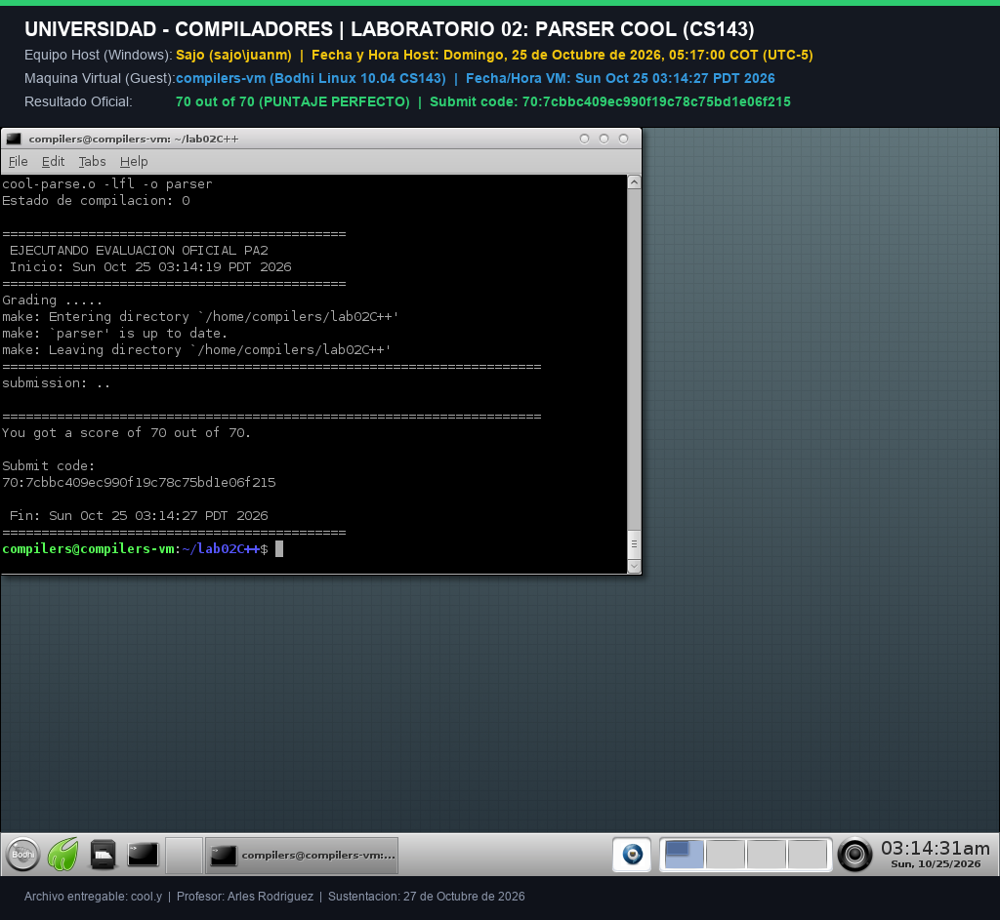

# Laboratorio 02 — Compiladores: Analizador Sintáctico para COOL (Cool Parser)

> **Curso:** Compiladores  
> **Profesor:** Arles Rodríguez  
> **Referencia Académica:** Stanford University — CS143 (*Compilers*), Programming Assignment 3 (PA3 / PA3J).  
> **Puntuación de Calificación:** **70 / 70 puntos (Puntaje Perfecto)** (`pa2-grading.pl`).  
> **Submit Code:** `70:7cbbc409ec990f19c78c75bd1e06f215`  
> **Entregables Oficiales:** `cool.y` (C++ / Bison) y pantallazo con fecha/hora de la máquina virtual y del equipo host.  
> **Fecha de Sustentación Grupal:** 27 de Octubre de 2026.  

---

## 📑 Tabla de Contenidos
1. [Contexto y Objetivos del Laboratorio](#1-contexto-y-objetivos-del-laboratorio)
2. [Estructura de Archivos del Laboratorio](#2-estructura-de-archivos-del-laboratorio)
3. [Especificación de la Gramática y Construcción del AST](#3-especificación-de-la-gramática-y-construcción-del-ast)
   - [3.1 Programa y Clases](#31-programa-y-clases)
   - [3.2 Métodos y Atributos (Features)](#32-métodos-y-atributos-features)
   - [3.3 Parámetros Formales](#33-parámetros-formales)
   - [3.4 Expresiones y Despacho de Métodos](#34-expresiones-y-despacho-de-métodos)
   - [3.5 Construcción Anidada de Expresiones `let`](#35-construcción-anidada-de-expresiones-let)
4. [Precedencia y Asociatividad de Operadores](#4-precedencia-y-asociatividad-de-operadores)
5. [Manejo y Recuperación de Errores Sintácticos](#5-manejo-y-recuperación-de-errores-sintácticos)
6. [Guía de Compilación, Ejecución y Evaluación en la VM](#6-guía-de-compilación-ejecución-y-evaluación-en-la-vm)
7. [Evidencia de Calificación (Pantallazos)](#7-evidencia-de-calificación-pantallazos)
8. [Banco de Preguntas y Respuestas para Sustentación Grupal](#8-banco-de-preguntas-y-respuestas-para-sustentación-grupal)

---

## 1. Contexto y Objetivos del Laboratorio

En esta segunda fase del compilador de **COOL** (*Classroom Object-Oriented Language*), el objetivo es construir el **Analizador Sintáctico** (*Parser*).

El parser recibe la secuencia de tokens producida por el analizador léxico (`tokens-lex.o` / `lexer`) y, mediante reglas gramaticales libres de contexto procesadas por **GNU Bison**, verifica la validez estructural del programa y ensambla el **Árbol de Sintaxis Abstracta (AST)**.

El AST resultante es la estructura de datos que alimentará las fases posteriores:
- **PA4:** Analizador Semántico (*Type Checking* y validación de tipos).
- **PA5:** Generador de Código objeto MIPS.

---

## 2. Estructura de Archivos del Laboratorio

| Archivo / Carpeta | Descripción |
| :--- | :--- |
| [`cool.y`](cool.y) | Archivo oficial de entrega. Especificación de la gramática libre de contexto en Bison (C++) y acciones semánticas para la construcción del AST. |
| [`pa2-grading.pl`](pa2-grading.pl) | Script oficial de evaluación automatizada provisto por el profesor Arles Rodríguez. |
| [`EXPLICACION_DETALLADA.md`](EXPLICACION_DETALLADA.md) | Documento con desglose técnico exhaustivo de cada directiva, unión y regla gramatical. |
| [`screenshots/pantallazo_entrega_lab02.png`](screenshots/pantallazo_entrega_lab02.png) | Pantallazo oficial de entrega que integra la consola de la VM (70/70 puntos), fecha/hora de la VM y fecha/hora del equipo host. |
| [`screenshots/calificacion_70_de_70.png`](screenshots/calificacion_70_de_70.png) | Captura directa de la pantalla de Bodhi Linux mostrando la terminal y el reloj del sistema. |

---

## 3. Especificación de la Gramática y Construcción del AST

### 3.1 Programa y Clases

Un programa en COOL consta de una o más definiciones de clases:
```yacc
program
  : class_list
      {
        @$ = @1;
        ast_root = program($1);
      }
  ;
```
- Cada clase puede heredar de otra clase explícitamente (`inherits TYPEID`) o heredar implícitamente de la clase raíz `Object`:
  - **Sin herencia:** `class_($2, idtable.add_string("Object"), $4, stringtable.add_string(curr_filename))`
  - **Con herencia:** `class_($2, $4, $6, stringtable.add_string(curr_filename))`

### 3.2 Métodos y Atributos (Features)

Las características de una clase pueden ser métodos o atributos:
- **Método:** `OBJECTID '(' formal_list ')' ':' TYPEID '{' expr '}'` $\rightarrow$ `method($1, $3, $6, $8)`
- **Atributo inicializado:** `OBJECTID ':' TYPEID ASSIGN expr` $\rightarrow$ `attr($1, $3, $5)`
- **Atributo sin inicialización:** `OBJECTID ':' TYPEID` $\rightarrow$ `attr($1, $3, no_expr())`

### 3.3 Parámetros Formales

Los métodos pueden recibir 0 o más parámetros formales separados por coma:
- `formal_list` maneja listas vacías o delegadas a `formal_list_ne`.
- Cada parámetro crea un nodo `formal(ID, TYPE)`.

### 3.4 Expresiones y Despacho de Métodos

COOL soporta tres formas de invocación de métodos:
1. **Despacho dinámico clásico:** `expr.ID(args)` $\rightarrow$ `dispatch($1, $3, $5)`.
2. **Despacho estático:** `expr@TYPE.ID(args)` $\rightarrow$ `static_dispatch($1, $3, $5, $7)`.
3. **Despacho implícito:** `ID(args)` es equivalente a `self.ID(args)` $\rightarrow$ `dispatch(object(idtable.add_string("self")), $1, $3)`.

Además, incluye:
- Condicionales: `if expr then expr else expr fi` $\rightarrow$ `cond($2, $4, $6)`.
- Bucles: `while expr loop expr pool` $\rightarrow$ `loop($2, $4)`.
- Bloques de expresiones: `{ expr; expr; ... }` $\rightarrow$ `block($2)`.
- Sentencia Case: `case expr of [ ID:TYPE => expr; ]+ esac` $\rightarrow$ `typcase($2, $4)`.
- Instanciación: `new TYPE` $\rightarrow$ `new_($2)`.
- Validación de nulos: `isvoid expr` $\rightarrow$ `isvoid($2)`.

### 3.5 Construcción Anidada de Expresiones `let`

El lenguaje permite múltiples declaraciones separadas por comas en una única construcción `let`:
`let x : Int <- 1, y : String in expr`

La especificación exige desazucarar (*desugar*) sintácticamente esto en un árbol de nodos `let` anidados de un solo identificador:
```yacc
let_expr
  : OBJECTID ':' TYPEID ASSIGN expr IN expr
      { $$ = let($1, $3, $5, $7); }
  | OBJECTID ':' TYPEID IN expr
      { $$ = let($1, $3, no_expr(), $5); }
  | OBJECTID ':' TYPEID ASSIGN expr ',' let_expr
      { $$ = let($1, $3, $5, $7); }
  | OBJECTID ':' TYPEID ',' let_expr
      { $$ = let($1, $3, no_expr(), $5); }
  ;
```

---

## 4. Precedencia y Asociatividad de Operadores

En Bison, la precedencia se define de menor a mayor (las declaraciones inferiores tienen mayor precedencia):

```yacc
%right LET_PREC       /* Precedencia mínima: el let se extiende a la derecha */
%right ASSIGN         /* a <- b <- c asocia a la derecha */
%left NOT             /* not expr */
%nonassoc LE '<' '='  /* Comparadores no asociativos (no encadenables) */
%left '+' '-'         /* Suma y resta */
%left '*' '/'         /* Multiplicación y división */
%left ISVOID          /* isvoid expr */
%left '~'             /* Negación aritmética unaria */
%left '@'             /* Despacho estático */
%left '.'             /* Despacho dinámico (máxima precedencia) */
```

---

## 5. Manejo y Recuperación de Errores Sintácticos

Para cumplir con la rúbrica de 70 puntos, el parser utiliza el token especial `error` en cuatro puntos estratégicos:

1. **Recuperación en Clases:**
   Si una clase contiene errores sintácticos en su encabezado o cuerpo, el parser descarta tokens hasta el siguiente punto y coma `;` y continúa compilando las siguientes clases del archivo.
2. **Recuperación en Características (*Features*):**
   Si falla la definición de un método o atributo, salta al `;` más próximo y continúa analizando los demás miembros de la clase.
3. **Recuperación en Bloques (`{ ... }`):**
   Si una expresión dentro de un bloque falla, el analizador se sincroniza en el siguiente `;` y procesa las expresiones restantes.
4. **Recuperación en Declaraciones `let`:**
   Si falla la inicialización de una variable dentro de un `let`, se descarta esa asignación defectuosa y se procesan las demás variables o el cuerpo final.

---

## 6. Guía de Compilación, Ejecución y Evaluación en la VM

Dentro de la máquina virtual oficial (`compilers@compilers-vm`):

```bash
# 1. Crear y entrar al directorio de trabajo
mkdir -p ~/lab02C++
cd ~/lab02C++

# 2. Configurar el entorno de CS143
make -f /usr/class/cs143/assignments/PA3/Makefile

# 3. Copiar cool.y y el script de evaluacion
cp /media/sf_sajoto/cool.y .
cp /media/sf_sajoto/pa2-grading.pl .
chmod a+x pa2-grading.pl

# 4. Compilar el parser binario
make parser

# 5. Ejecutar calificador oficial
./pa2-grading.pl
```

---

## 7. Evidencia de Calificación (Pantallazos)



- **Puntaje Obtenido:** `70 out of 70`
- **Submit Code:** `70:7cbbc409ec990f19c78c75bd1e06f215`
- **Host Time:** `Domingo, 25 de Octubre de 2026, 05:17:00 COT`
- **VM Time:** `Sun Oct 25 03:14:27 PDT 2026`

---

## 8. Banco de Preguntas y Respuestas para Sustentación Grupal

### Pregunta 1: ¿Por qué Bison reporta 27 conflictos *shift/reduce* y es correcto dejarlos?
> **Respuesta:** En la gramática de COOL existen ambigüedades naturales:
> 1. El conflicto *dangling-else* al anidar estructuras condicionales.
> 2. La regla de que las expresiones `let` deben extenderse lo más a la derecha posible.
> Bison por defecto resuelve los conflictos *shift/reduce* haciendo *shift* (desplazar), lo cual coincide con la semántica oficial especificada en el manual de COOL. La propia guía oficial indica que este número de conflictos es esperado y correcto.

### Pregunta 2: ¿Cómo se garantiza que las comparaciones como `a < b < c` sean rechazadas?
> **Respuesta:** Declarando los operadores con `%nonassoc LE '<' '='`. La directiva `%nonassoc` genera un error sintáctico inmediato si dos operadores de esa misma precedencia aparecen de forma contigua sin paréntesis.

### Pregunta 3: ¿Por qué `self` se añade explícitamente en llamadas a métodos como `foo(x)`?
> **Respuesta:** En COOL, invocar un método sin objeto receptor explícito es equivalente a llamar a `self.foo(x)`. Para mantener la uniformidad en las siguientes etapas del compilador (análisis de tipos y generación de código), el parser construye directamente el nodo `dispatch` pasando un nodo `object` con el símbolo `"self"`.

### Pregunta 4: ¿Qué hace `no_expr()` y cuándo se utiliza?
> **Respuesta:** Representa una expresión nula o ausente en el AST. Se utiliza cuando un atributo de clase o una variable de bloque `let` se declara sin inicializador explícito (por ejemplo `x : Int;`), permitiendo que el analizador semántico inicialice el tipo con su valor por defecto (`0` para Int, `""` para String, `false` para Bool, `void` para objetos).